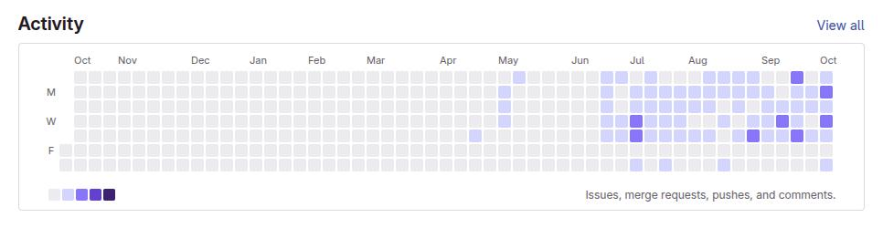

  

<h2 align="center">👨‍💻 Who am I</h2>

<samp>
  Hi, I'm <b>Jithan Roy</b>, a Full-Stack Software Engineer based in Dhaka, Bangladesh[cite: 1]. Currently, I work at <b>TechnoNext Ltd.</b>, building scalable web applications and backend systems[cite: 1]. I love designing and building projects centered around human-computer interaction.  
  🌱 This year, I am focused on mastering <b>backend and devops</b> and advanced database engineering alongside my day-to-day job[cite: 1], while dedicating time to build.
</samp>
    
  <!-- Fixed username from csalkemy to JithanRoy -->
  &nbsp;
  

<h2 align="center">🔭 Tools of Trade</h2>

   
  <b>Frontend & Mobile</b> 
  &nbsp;
  &nbsp;
  &nbsp;
  &nbsp;
  &nbsp;
  &nbsp;
  &nbsp;
  

  
<b>Styling & UI</b> 
&nbsp;
&nbsp;
&nbsp;
&nbsp;
&nbsp;
&nbsp;
&nbsp;

  
<b>Backend, Database & Tools</b> 
&nbsp;
&nbsp;
&nbsp;
&nbsp;
&nbsp;
&nbsp;
&nbsp;
&nbsp;

<h2 align="center">📈 My GitHub Stats</h2>

  
  

  

<h2 align="center">📫 Reach Me On</h2>

  &nbsp;&nbsp;&nbsp;&nbsp;
  

